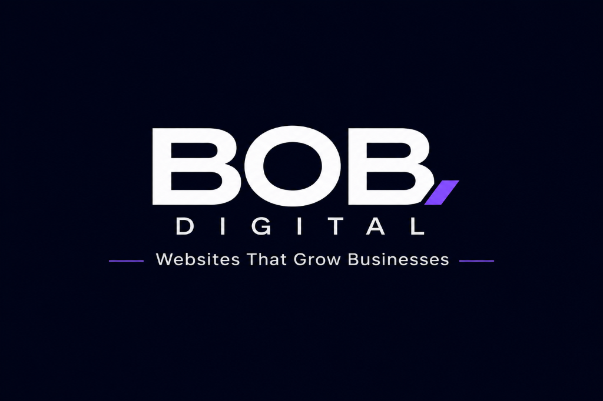

# BOB DIGITAL — Websites That Grow Businesses

Official website for **BOB DIGITAL**, a Hyderabad-based premium web development studio founded by **Sardar Balwinder Singh**.



## Overview
BOB DIGITAL specializes in high-impact, business-driven digital solutions:
- **Website Development**: High-performance, branded business websites.
- **E-Commerce Platforms**: Conversion-optimized storefronts with Razorpay, UPI, and instant cart flows.
- **Custom Website Development**: Bespoke React/Vite web apps, client portals, and APIs.
- **Website Management & Maintenance**: 24/7 uptime monitoring, daily automated cloud backups, security hardening, and performance optimization.

---

## Brand Identity
- **Primary Color**: Midnight Navy (`#050B20`)
- **Accent Color**: Vivid Violet (`#5938E8`)
- **Background**: Warm White (`#F7F7FA`)
- **Typography**: Inter & Manrope
- **Contact Email**: bobdigitalpvt@gmail.com
- **WhatsApp**: +91 6303248510
- **Location**: Hyderabad, Telangana, India

---

## Tech Stack
- **Framework**: React 19 + Vite 8
- **Icons**: Lucide React
- **Animations**: CSS3 Keyframes & Hardware-Accelerated Transforms
- **Feedback**: Canvas-Confetti
- **Deployment**: Vercel Ready

---

## Local Development

```bash
# Install dependencies
npm install

# Start local dev server
npm run dev

# Build for production
npm run build

# Preview production build
npm run preview
```

---

## Deploy to Vercel

1. Import this repository in [Vercel Dashboard](https://vercel.com/new).
2. Framework Preset: **Vite**
3. Build Command: `npm run build`
4. Output Directory: `dist`
5. Click **Deploy**.

---

© 2026 BOB DIGITAL. All rights reserved. Crafted with precision in Hyderabad, India.
